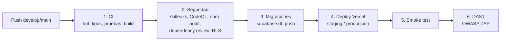

# NOMBRE DEL SISTEMA

> README provisional de la plantilla. La skill `/evidencias` lo reemplaza al final del examen.

## Stack
Next.js 16 + React 19 + TypeScript + Tailwind 4 · Supabase (PostgreSQL, Auth, RLS) · Vercel · GitHub Actions · Vitest · zod

## Pipeline DevSecOps

En cada PR corren CI y Seguridad; la rama protegida no deja hacer merge si fallan.

## Correr en local
```bash
cp .env.example .env.local   # completar valores
npm ci
npm run dev                  # http://localhost:3000
npm run verificar            # lint + tipos + pruebas + build
```

## Documentación
`docs/01-analisis.md` · `docs/02-backlog.md` · `docs/03-arquitectura.md` · `docs/05-seguridad.md` · `docs/06-evidencias.md`
